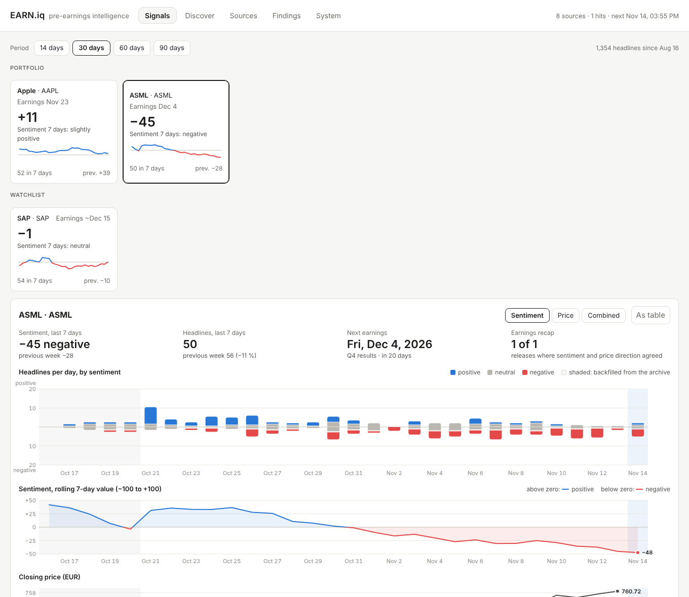
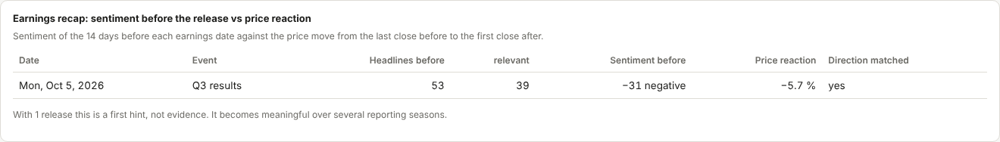
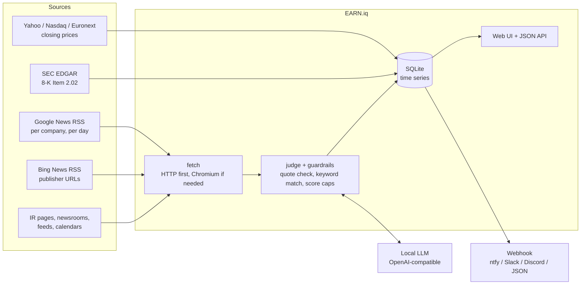

# EARN.iq

**Self-hosted pre-earnings intelligence with a local LLM.**

EARN.iq follows the news flow around the companies you care about, scores every headline with a model running on your own hardware, and shows how sentiment built up in the weeks before each earnings release, and how the stock reacted afterwards. It also watches investor relations pages for new results releases, earnings presentations and call transcripts, and pulls out guidance changes with a verbatim quote as evidence.



> **Not investment advice.** EARN.iq is a research tool. It counts and classifies what is being written; it does not know what will happen. See [Disclaimer](#disclaimer).

## Why

Before a company reports, the news already moves: analysts adjust targets, suppliers drop hints, customers announce orders, a regulator steps in. Reading all of it for a handful of companies is a part-time job. Asking a chatbot is not an answer either: it summarises confidently, invents numbers, and cannot tell you what it said last week.

EARN.iq takes a different route:

- **Every headline is a data point.** Scored one by one (sentiment -2 to +2, relevance 0 to 3, topic), stored with its date, aggregated into a rolling 7-day sentiment and a volume series.
- **The earnings date is the anchor.** Each company card counts down to the next release; the recap compares the sentiment of the 14 days before each past release with the price reaction from the last close before to the first close after.
- **Your model, your machine.** Any OpenAI-compatible endpoint works: Ollama, LM Studio, llama.cpp, mlx_lm, vLLM. Nothing leaves your network except the page requests themselves.
- **The model does not get the last word.** Wherever a local model failed during calibration, the decision moved into code. See [Guardrails](#guardrails-why-the-model-does-not-get-the-last-word).

## What it does

| Area | What you get |
|---|---|
| **Signals** | Per company: headlines per day split into positive, neutral and negative; rolling 7-day sentiment; closing prices; a combined view of price and sentiment with a simple lead/lag correlation; every headline with its score, outlet and topic. |
| **Earnings recap** | For every past earnings date: sentiment in the 14 days before, price reaction after, and whether the direction matched. Past dates come from SEC 8-K filings (Item 2.02) for US filers, or from your own entries. |
| **Monitors** | Pages watched on a schedule (IR sites, newsrooms, feeds, financial calendars) and judged against criteria you write in plain language, with fields the model fills in (document type, period, guidance, revenue, next earnings date) and a quote that is checked against the page. Ships with an *Earnings materials* monitor and a *Large orders* monitor. |
| **Article reading** | The newest articles per company are fetched in full and read by the model; a read article replaces the score of its headline and counts 1.5x. Paywalls and bot walls stay unread. |
| **Discover** | Companies outside your list that stand out positively across several outlets, from broad market searches ("raises full-year guidance", "hebt Prognose an", "relève ses prévisions") and from articles about your companies. Tickers are verified by code, not by the model. |
| **Trends and alerts** | A rule that fires when sentiment turns (7 days vs the 21 days before, with minimum volume), plus event alerts for guidance changes, profit warnings, regulatory, legal and management news. Delivered via webhook: JSON, ntfy, Slack or Discord, with a daily cap. |

<p align="center"></p>

## How it works



Two background threads do the work, both serial on purpose: one runs the monitors, one collects and scores headlines, reads articles, fetches prices and checks trends. A local model is usually shared with other tools, so EARN.iq pauses between calls instead of flooding it.

Design decisions that shape the behaviour:

- **HTTP first, Chromium only if needed.** A single request covers feeds, JSON APIs and server-rendered pages. Chromium (as a subprocess, no Playwright) is used on 4xx, bot walls, too little text, or pages that deliver lots of markup and little text. That last check matters: a dashboard measured at 45,709 characters of HTML contained only 510 characters of text before rendering.
- **Judge only what changed.** Page texts are hashed; an unchanged page gets no second verdict. Hourly fetching turns into a handful of model calls per day.
- **No model, no verdict.** If the model is offline or its answer is cut off, nothing is stored that could later look like a score of 0. The fetch stays, the verdict is caught up as soon as the model is back.
- **Repeats do not count twice.** A page that changes only incidentally (counters, ordering) would otherwise report the same hit again and again. In one test week that was 240 hits, of which 38 were distinct.
- **Blocks are detected, not bypassed.** HTTP 401/402/403/407/429/451 and bot walls (Cloudflare, TollBit, "enable JavaScript") mark the source as blocked and put it into backoff.

## Guardrails: why the model does not get the last word

The project was calibrated against a local 30B mixture-of-experts model (Qwen3-30B-A3B, 4-bit). It is good at reading and summarising. It is not reliable at anything that has a single correct answer. Each guardrail below exists because of a concrete failure:

| Failure seen during calibration | Guardrail in code |
|---|---|
| A company was marked as "on the watchlist" although it was not, even after the prompt was sharpened twice | `match`: list lookups are done by code against a keyword list |
| A USD 196 million contract was rated as "above the USD 1 billion threshold" | `cap`: the model supplies the number, code compares and caps the score |
| Asked for the number itself, the model converted units (196 -> 196200) or invented an amount where the text named none | Numbers must appear in the page text, otherwise they count as missing |
| Quotes that looked plausible but were not on the page | Every quote is checked against the stored text and flagged if not found |
| A truncated answer became a finding with score 0 | `finish_reason` is checked; incomplete answers are discarded |
| SEC filing feeds contain only item numbers; the model made up their content | Such feeds are used for dates only, never for judgement |

Rule of thumb for your own monitors: **anything that can be decided from a finite list or computed belongs in a field rule, not in the prompt.**

## Quick start

### Try it with demo data (no model needed)

```bash
git clone https://github.com/<you>/earniq.git && cd earniq
python3 -m venv .venv && . .venv/bin/activate
pip install -r requirements.txt
EARNIQ_DATA_DIR=./demo-data python -m earniq.demo
EARNIQ_DATA_DIR=./demo-data EARNIQ_WORKERS=0 uvicorn earniq.server:app --port 8106
# open http://localhost:8106
```

All demo headlines are synthetic and start with `[demo]`.

### Docker

```bash
cp .env.example .env        # set EARNIQ_LLM_BASE_URL and EARNIQ_LLM_MODEL
docker compose up -d --build
# open http://localhost:8106
```

The image includes Chromium and runs on amd64 and arm64 (Raspberry Pi 4/5). To reach a model on the Docker host, use `http://host.docker.internal:11434/v1`.

### Bare metal

```bash
python3 -m venv .venv && . .venv/bin/activate
pip install -r requirements.txt
sudo apt install chromium-headless-shell   # Debian; or chromium, or use an installed Chrome
cp .env.example .env
uvicorn earniq.server:app --host 127.0.0.1 --port 8106
```

A hardened systemd unit is in [`deploy/earniq.service`](deploy/earniq.service).

On first start EARN.iq copies the example watchlist (Apple, ASML, SAP) to `data/watchlist.json` and imports the example monitors. Replace them in the *Sources* tab. Set `EARNIQ_SEED_EXAMPLES=0` to start empty.

### Choosing a model

Anything with an OpenAI-compatible `/v1/chat/completions` endpoint works. Reliable JSON output and instruction following matter more than size. Reasoning models are fine; `<think>` blocks are stripped. The reference setup is Qwen3-30B-A3B (4-bit) on Apple silicon; smaller models will work, and the guardrails matter more the smaller the model gets. Check the first findings and headline scores before you trust them. Hosted APIs work too (`EARNIQ_LLM_API_KEY`), if you are fine with sending page texts there.

## Configuration

### Environment

| Variable | Default | Purpose |
|---|---|---|
| `EARNIQ_LLM_BASE_URL` | `http://localhost:11434/v1` | OpenAI-compatible base URL including `/v1` |
| `EARNIQ_LLM_MODEL` | empty | Model name; required by Ollama and hosted APIs |
| `EARNIQ_LLM_API_KEY` / `_FILE` | empty | Bearer token, or a file containing it |
| `EARNIQ_LLM_TIMEOUT` | `300` | Seconds per model call |
| `EARNIQ_SUMMARY_LANGUAGE` | `English` | Language of summaries in findings |
| `EARNIQ_DATA_DIR` | `./data` | Database and `watchlist.json` |
| `EARNIQ_CHROMIUM` | auto | Path to Chromium or Chrome |
| `EARNIQ_SEC_USER_AGENT` / `_FILE` | empty | "Name email" as required by the SEC; enables past earnings dates for US filers |
| `EARNIQ_ALERT_WEBHOOK_URL` | empty | Where alerts go |
| `EARNIQ_ALERT_FORMAT` | `json` | `json`, `ntfy`, `slack` or `discord` |
| `EARNIQ_ALERT_MAX_PER_DAY` | `8` | Cap for events and trends together |
| `EARNIQ_BASIC_AUTH` / `_FILE` | empty | `user:password` for the web UI and API |
| `EARNIQ_SEED_EXAMPLES` | `1` | Load example watchlist and monitors on first start |
| `EARNIQ_WORKERS` | `1` | `0` disables background fetching and scoring |

A `.env` file in the project directory is read automatically; real environment variables take precedence.

### Watchlist (`data/watchlist.json`)

Edited through the *Sources* tab. Each company has a group (`portfolio` gets event alerts, `watchlist` does not, `auto` is managed by Discover), one or more Google News searches with a language, an optional context sentence for disambiguation ("Not meant: the fruit"), price symbols, an optional SEC CIK, and earnings dates:

```json
{
  "key": "asml", "name": "ASML", "group": "portfolio",
  "ticker": "ASML", "quote": "ASML.AS", "euronext": "NL0010273215-XAMS",
  "context": "Dutch maker of lithography systems for chip production.",
  "searches": [{"q": "ASML (earnings OR bookings OR guidance OR EUV)", "lang": "en"}],
  "next": [{"day": "2027-01-27", "kind": "Q4 2026", "confirmed": false}],
  "past": []
}
```

`earnings_monitor` names the monitor whose criteria carry an auto-generated block with your watchlist and the next earnings dates. New companies get a Google News source in that monitor.

### Monitors as code

Monitors live in the database but import and export as JSON (*System* tab, or `POST /api/import`, `GET /api/export/config.json`), so you can keep them in Git. Matching is by monitor name and source URL; existing sources keep their history.

```json
{
  "name": "Large orders",
  "criteria": "Relevant: a new order of USD 1 billion or more ... Not relevant: ...",
  "threshold": 65,
  "fields": [
    {"name": "topic", "description": "one of: order, partnership, other"},
    {"name": "company", "description": "company receiving the order"},
    {"name": "on_watchlist", "match": ["apple", "asml", "sap"], "against": "company"},
    {"name": "volume_musd", "description": "order value in USD millions, null if not stated",
     "cap": {"below": 1000, "score": 30, "if_missing": 40, "when": {"topic": ["order"]}}}
  ],
  "sources": [{"url": "https://news.google.com/rss/search?q=ASML+order+when:7d", "title": "ASML · orders"}]
}
```

- `match` / `against`: true if one of the keywords appears in the named field (or the whole page). The matched keyword is stored as `<name>_match`.
- `cap`: if the number is below `below`, the score is capped at `score`; if there is no number in the text, at `if_missing`; only when the `when` conditions hold.

Write criteria with an explicit "not relevant" part. In practice that sentence moves scores more than anything else: during calibration, a newsroom item about an AI shopping assistant dropped from 80 to 10 after adding "the topic weighs more than the sender".

The full API is documented at `/api/docs`.

## Data sources and etiquette

| Source | Used for | Notes |
|---|---|---|
| Google News RSS | headlines per company and day | public RSS; archive thins out with age, so backfilled days are marked and volume is only compared on live days |
| Bing News RSS | article URLs, market searches | public RSS |
| Publisher sites | full article text | fetched once; paywalls and bot walls are respected |
| Yahoo Finance, Nasdaq, Euronext | daily closing prices | unofficial public endpoints that can change or rate-limit at any time; on 429 EARN.iq switches source instead of retrying harder |
| SEC EDGAR | past earnings dates (8-K Item 2.02) | requires a declared user agent (`EARNIQ_SEC_USER_AGENT`) |
| Your monitor sources | IR pages, newsrooms, feeds | your choice; check each site's terms |

You are responsible for complying with the terms of the sites you query. EARN.iq keeps request rates low (pauses between requests, one Chromium at a time, backoff on errors) and never circumvents blocks.

## Security

EARN.iq has no user management. Run it on a private network (LAN, VPN, Tailscale), or set `EARNIQ_BASIC_AUTH` and put it behind a reverse proxy with TLS. The Docker Compose file binds to `127.0.0.1` by default. Secrets can be passed as files (`*_FILE`). The database contains your watchlist and everything collected; back up `data/`.

## Limitations

- Headline sentiment is a crude instrument. Volume and direction over time are more informative than any single day.
- The recap needs several reporting seasons before "direction matched" means anything. With one or two releases it is a hint, not evidence.
- Price data comes from unofficial endpoints and may have gaps.
- Google News archive depth varies; backfilled history is incomplete by nature.
- One SQLite file, one process. Designed for a few dozen companies, not an index.

## Development

```bash
pip install -r requirements-dev.txt
pytest
```

The tests mock the network and the model and cover the guardrails, the monitor runner, import/export and the company API. The code is plain Python modules under `earniq/` and a single-file UI in `web/index.html` (no build step).

| Module | Responsibility |
|---|---|
| `fetch.py` | HTTP and Chromium fetching, text extraction, block detection, diff |
| `llm.py` | OpenAI-compatible client, JSON extraction |
| `judge.py` | Verdicts against criteria, quote check, keyword match, score caps |
| `monitor.py` | Monitor runner: schedule, change detection, repeats, backoff |
| `signals.py` | Headlines, prices, earnings dates, aggregation, watchlist |
| `articles.py` | Full-text reading for watched companies |
| `discovery.py` | Market searches, ticker verification, candidates |
| `trends.py` | Sentiment-turn rule, auto-watch |
| `alerts.py` | Webhook delivery with daily cap |
| `server.py` | FastAPI app, API, basic auth |

Contributions are welcome, see [CONTRIBUTING.md](CONTRIBUTING.md).

## Disclaimer

EARN.iq is provided for research and educational purposes. It does not provide investment, financial, legal or tax advice, and nothing it shows is a recommendation to buy or sell any security. Scores are produced by a language model and simple rules; they can be wrong. Do your own research and consult a licensed professional before making investment decisions. The authors accept no liability for decisions made on the basis of this software.

## License

[MIT](LICENSE)
